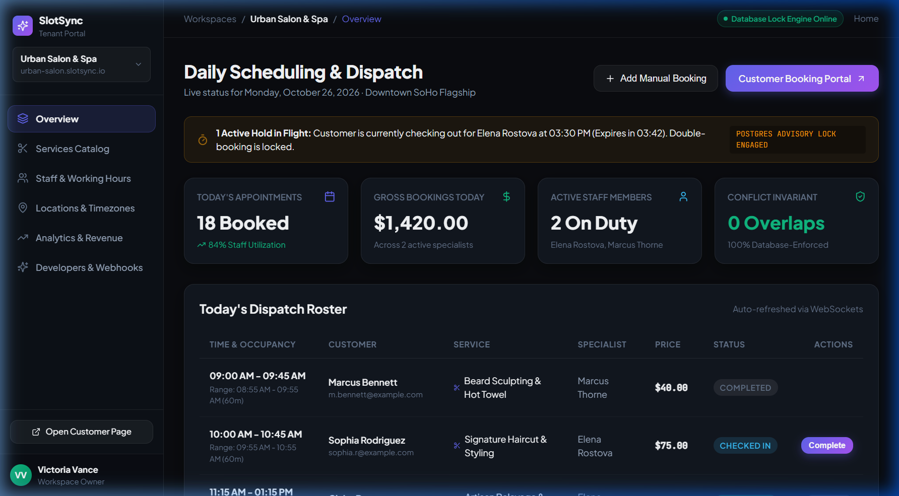
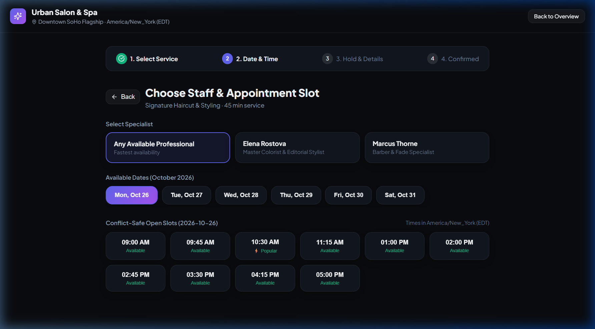
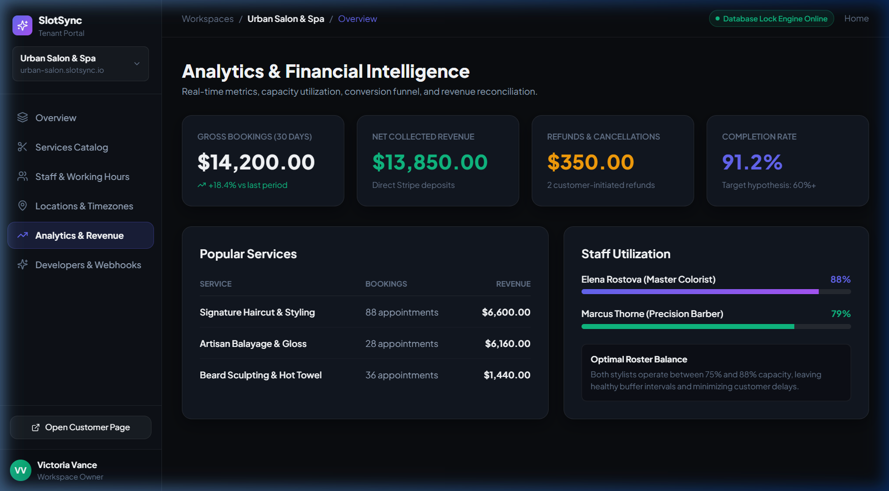

<div align="center">

# ⚡ SlotSync

### Multi-Tenant Booking & Scheduling Infrastructure SaaS
**Full-Stack B2B SaaS · Scheduling-as-a-Service · Production Architecture**

[](https://nextjs.org/)
[](https://nestjs.org/)
[](https://www.typescriptlang.org/)
[](https://www.postgresql.org/)
[](https://www.prisma.io/)
[](https://turbo.build/)

<p align="center">
  A high-performance scheduling engine enabling service businesses to accept appointments, coordinate staff and resources, process payments, and synchronize calendars with <strong>zero double bookings guaranteed at the storage engine level</strong>.
</p>

[Live Demos](#-user-interfaces) · [Architecture](#-system-architecture) · [Concurrency Guarantee](#-concurrency--conflict-prevention) · [API Specification](#-rest-api-catalog) · [Getting Started](#-getting-started)

---

</div>

## 🖼️ User Interfaces & Dashboards

### 1. Business Operational Dispatch Dashboard
> Real-time daily dispatch roster, staff utilization metrics, active temporary hold tracking, and database lock monitors.

<p align="center">
  
</p>

---

### 2. Frictionless Customer Booking Portal
> 4-step responsive customer booking flow featuring real-time conflict-safe slot generation, specialist selector, and active 5-minute reservation hold countdowns.

<p align="center">
  
</p>

---

### 3. Analytics & Financial Intelligence Studio
> Real-time gross bookings, net collected revenue, cancellation rates, staff workload balancing, and Stripe payment reconciliation.

<p align="center">
  
</p>

---

## 🔒 Concurrency & Conflict Prevention Guarantee

SlotSync's primary invariant is: **Zero overlapping confirmed exclusive allocations and zero double-booked temporary holds.**

```
                            Customer Hold / Booking Attempt
                                           │
                                           ▼
                            BEGIN POSTGRES TRANSACTION
                                           │
                                           ▼
                     Acquire Lexicographically Ordered Locks:
                     SELECT pg_advisory_xact_lock(hashtext(resource_id))
                     (Prevents multi-resource deadlocks)
                                           │
                                           ▼
                     Check In-Database Occupancy Overlap:
                     1. Confirmed allocations (occupancy_range &&)
                     2. Active holds (expires_at > clock_timestamp())
                                           │
                           ┌───────────────┴───────────────┐
                     Is Overlapping?                 Is Available?
                           │                               │
                          YES                              NO
                           │                               │
                           ▼                               ▼
                 ROLLBACK TRANSACTION               COMMIT TRANSACTION
                 HTTP 409 Conflict                  Hold / Allocation Granted
                 SLOT_UNAVAILABLE                   5-Minute Expiry Set
```

### PostgreSQL Range Exclusion (`btree_gist`)
Located in [`packages/database/prisma/migrations/001_reservation_allocations_exclusion_constraint.sql`](file:///d:/genai_projects/SlotSync/packages/database/prisma/migrations/001_reservation_allocations_exclusion_constraint.sql):
```sql
CREATE EXTENSION IF NOT EXISTS "btree_gist";

-- Storage-engine enforced exclusion constraint:
ALTER TABLE "reservation_allocations"
ADD CONSTRAINT "no_overlapping_confirmed_allocations"
EXCLUDE USING gist (
  "resource_id" WITH =,
  "occupancy_range" WITH &&
)
WHERE ("status" = 'CONFIRMED');
```

- **Occupancy Interval Modeling**: All reservations evaluate `[startsAt - bufferBefore, endsAt + bufferAfter)`. A 45-minute haircut with a 5-minute setup and 10-minute cleanup occupies a full 60-minute exclusive block.
- **Authoritative Database Clock**: Expired holds are invalidated using database time (`NOW()`), ensuring delayed queue workers never compromise availability correctness.

### 🧪 Concurrency Burst Test (PRD Section 17.2)
Simulating **100 customers attempting to reserve the exact same stylist and slot simultaneously**:

```
======================================================
🚀 Starting Concurrency Burst Test: 100 simultaneous reservations
Target: Staff Elena Rostova at 2026-10-26T10:00:00Z (45 mins)
======================================================

📊 Concurrency Simulation Results:
- Total Simultaneous Requests: 100
- Successful Reservations:     1 (Expected: 1)
- Rejected Conflicts (409):    99 (Expected: 99)
- Double-Booking Violations:   0 (Expected: 0)
- Zero-Overlap Invariant:      ✅ PASSED
```

---

## 🏛️ System Architecture & Monorepo Structure

```
slotsync/
├── apps/
│   ├── web/                          # Next.js 15 (App Router), React 19, Vanilla CSS Design System
│   │   ├── app/
│   │   │   ├── book/[slug]/          # 4-step customer booking flow with 5-minute live hold timer
│   │   │   │   └── reschedule/       # Zero-risk self-service appointment rescheduling
│   │   │   ├── embed/[slug]/         # Standalone clean embed view for external iframes
│   │   │   ├── dashboard/            # Business operational dispatch roster & live hold flight monitor
│   │   │   │   ├── services/         # Service catalog management (buffers & minor unit pricing)
│   │   │   │   ├── staff/            # Staff weekly schedules (Mon-Sun shift grid) & vacation overrides
│   │   │   │   ├── locations/        # Multi-branch locations with IANA timezone intelligence
│   │   │   │   ├── analytics/        # Revenue breakdown (gross/refund/net) & staff utilization
│   │   │   │   └── developers/       # API keys (sk_live_), webhooks (HMAC SHA-256), embed snippet
│   │   │   ├── globals.css           # Ultra-modern dark-mode design system with glassmorphism
│   │   │   └── page.tsx              # SaaS architecture & buffer occupancy visualizer
│   │   └── public/
│   │       └── widget.js             # 1-line embeddable script SDK for Webflow / Shopify / static HTML
│   ├── api/                          # NestJS REST & WebSocket API (/api/v1)
│   │   └── src/
│   │       ├── common/               # HttpExceptionFilter, JwtAuthGuard, RolesGuard, PrismaService
│   │       └── modules/
│   │           ├── auth/             # JWT auth, user registration, login
│   │           ├── tenants/          # Workspace creation and tenant data isolation
│   │           ├── locations/        # Branch locations, IANA timezones
│   │           ├── services/         # Service catalog with setup/cleanup buffers & minor unit pricing
│   │           ├── staff/            # Profiles, weekly schedules, vacation exceptions
│   │           ├── availability/     # Conflict-safe slot generation engine
│   │           ├── bookings/         # Temporary holds, advisory locks, transactions, confirmation
│   │           ├── payments/         # Checkout sessions, webhooks, PAYMENT_REVIEW reconciliation
│   │           ├── calendars/        # Google / Outlook OAuth connections, external busy intervals
│   │           ├── analytics/        # Financial intelligence & staff utilization aggregation
│   │           ├── developer/        # API keys and webhook subscription management
│   │           └── public/           # Public tenant information & services API
│   └── worker/                       # Dedicated Background Worker Service
│       └── src/
│           ├── hold-expiry.worker.ts # Automated release of expired reservation holds
│           ├── outbox.worker.ts      # HMAC SHA-256 signed webhook dispatch & notifications
│           ├── calendar-sync.worker.ts # Periodic external calendar reconciliation loop
│           └── main.ts               # Worker lifecycle with graceful shutdown
├── packages/
│   ├── database/                     # Prisma schema (26 models), client, seed, and migration SQL
│   └── shared-types/                 # Shared TypeScript DTOs, Enums, and State Machine contracts
├── tests/
│   └── concurrency.test.ts           # 100-request simultaneous burst stress test
├── .env.example
├── pnpm-workspace.yaml
├── turbo.json
└── package.json
```

---

## 🔌 1-Line Embeddable Widget SDK

SlotSync includes an embeddable widget script located at [`apps/web/public/widget.js`](file:///d:/genai_projects/SlotSync/apps/web/public/widget.js). Add this single line to any Webflow, Shopify, WordPress, or HTML site:

```html
<script 
  src="https://slotsync.io/widget.js" 
  data-slotsync-slug="urban-salon" 
  async>
</script>
```

---

## 📡 REST API Catalog (`/api/v1`)

### Public Booking Endpoints
| Method | Endpoint | Description |
| :--- | :--- | :--- |
| `GET` | `/public/:slug/info` | Workspace metadata and active locations |
| `GET` | `/public/:slug/services` | Bookable services with duration & buffer times |
| `GET` | `/public/:slug/availability` | Conflict-safe available slots for service/date/staff |
| `POST` | `/public/:slug/holds` | Acquire atomic 5-minute reservation hold |
| `POST` | `/public/:slug/bookings/confirm` | Confirm hold into finalized appointment |
| `GET` | `/public/:slug/bookings/:id` | View booking with secure management token |
| `POST` | `/public/:slug/bookings/:id/cancel` | Cancel booking and release allocations |
| `POST` | `/public/:slug/bookings/:id/reschedule`| Transactional zero-risk slot swap |

### Business & Staff Operations
| Method | Endpoint | Description |
| :--- | :--- | :--- |
| `POST` | `/auth/register` & `/login` | Tenant owner / staff authentication |
| `GET` | `/auth/me` | Current user profile and memberships |
| `GET` / `POST` | `/workspaces` | Multi-tenant workspace management |
| `GET` / `POST` | `/locations` | Branch locations and IANA timezone management |
| `GET` / `POST` | `/services` | Service catalog with buffers and pricing |
| `GET` / `POST` | `/staff` | Staff profiles and weekly schedule grids |
| `PUT` | `/staff/:id/working-hours` | Update weekly shift intervals and breaks |
| `POST` | `/staff/:id/exceptions` | Add vacation / time-off overrides |
| `GET` | `/analytics/summary` | Financial gross/net revenue & staff utilization |
| `POST` | `/payments/checkout-session/:slug`| Create hosted checkout session |
| `POST` | `/payments/webhook` | Idempotent webhook receiver with reconciliation |
| `POST` | `/developer/api-keys` | Generate `sk_live_...` API keys |
| `POST` | `/developer/webhooks` | Configure signed webhook destinations |

---

## 🚀 Getting Started

### Prerequisites
- Node.js `v20+` (tested on `v22.16.0`)
- pnpm `v10+` (tested on `v12.15.0`)
- PostgreSQL `v15+` with `btree_gist` extension

### Installation
```bash
# Clone the repository
git clone https://github.com/Harshith-ka/SlotSync.git
cd SlotSync

# Install dependencies across all packages
pnpm install

# Copy environment variables
cp .env.example .env
```

### Database Setup & Seeding
```bash
# Generate Prisma Client
pnpm db:generate

# Push schema and seed demo data (Urban Salon & Spa, Staff, Locations, Services)
pnpm db:push
pnpm db:seed
```

### Running Locally
```bash
# Run both Next.js Web App and NestJS Backend API concurrently:
pnpm dev
```

- **Customer Booking Flow**: [http://localhost:3000/book/urban-salon](http://localhost:3000/book/urban-salon)
- **Business Operational Dashboard**: [http://localhost:3000/dashboard](http://localhost:3000/dashboard)
- **Service Catalog**: [http://localhost:3000/dashboard/services](http://localhost:3000/dashboard/services)
- **Staff Working Hours**: [http://localhost:3000/dashboard/staff](http://localhost:3000/dashboard/staff)
- **Analytics Studio**: [http://localhost:3000/dashboard/analytics](http://localhost:3000/dashboard/analytics)
- **Developer Platform**: [http://localhost:3000/dashboard/developers](http://localhost:3000/dashboard/developers)
- **Standalone Embed Widget**: [http://localhost:3000/embed/urban-salon](http://localhost:3000/embed/urban-salon)
- **Backend API**: [http://localhost:4000/api/v1](http://localhost:4000/api/v1)

### Run Critical Concurrency Stress Test
```bash
pnpm --filter @slotsync/database exec tsx ../../tests/concurrency.test.ts
```

---

## 📜 License
MIT License · Built with precision for production-grade scheduling infrastructure.
